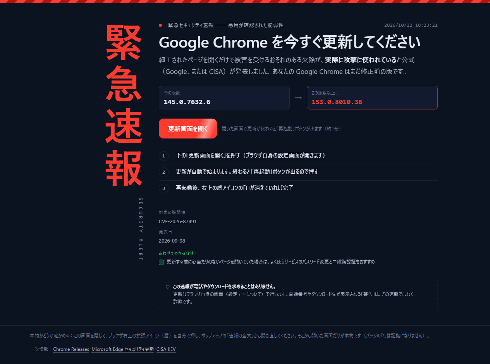
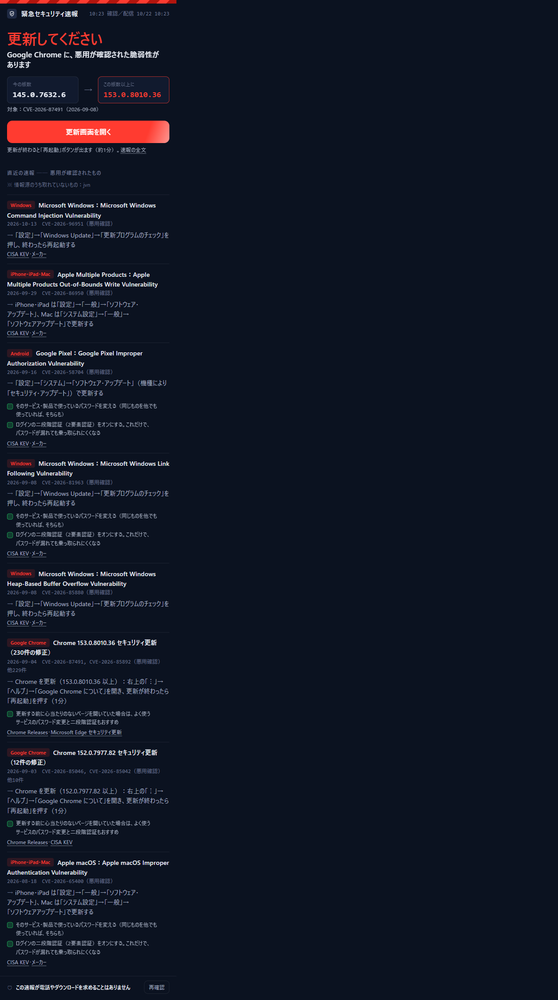

# 緊急セキュリティ速報

**悪用が確認された脆弱性で、あなたのブラウザが影響を受けるときだけ知らせる Chrome／Edge 拡張**と、その元になる公開フィードです。
地震速報と同じ考え方で、**めったに鳴りません**。鳴ったら「更新画面を開く」を押して再起動するだけです。

> この速報が電話やダウンロードを求めることはありません。
> 「ウイルスに感染しました」と電話番号を出す画面は、この拡張ではなく詐欺です。

- 公開フィード：https://zuboland.github.io/security-sokuho/ （`browsers.json` / `alerts.json` / `feed.json` / `status.json`）
- リポジトリ：https://github.com/zuboland/security-sokuho （MIT）

<p align="center"></p>
<p align="center"></p>

## 何が分かるか

| 表示 | 意味 |
|---|---|
| 🔴 更新してください | 悪用が確認された脆弱性があり、あなたの版数が修正版より古い |
| ✅ 対応済みです／いま緊急の速報はありません | 修正版以上、または直近に悪用確認済みの件が無い |
| ⚪ 確認できませんでした | 版数が取れない・情報源が止まっている。**「大丈夫」とは言いません**。手で確かめる手順を出します |

「確認できない」を「大丈夫」と言わないのが、この道具のいちばん大事な約束です。

## 仕組み

```
[GitHub Actions（30分ごと）] 公式の情報源を取得 → public/*.json → GitHub Pages で配信
[拡張]                       30分ごとに JSON を読む → 自分の版数と比べる → 要対応のときだけ通知
```

- **判定に AI を使いません。** 修正版の版数は Google／Microsoft／CISA の公式データから機械で取り、あなたの版数と比べます
- **あなたのPCの情報は外に出ません。** 外へ出る通信は公開フィード（静的JSON）の取得だけで、利用者を識別する情報は送りません
- **AI は日本語の要約（summary_ja）にだけ**（任意）。「誰に関係するか」「今やること」「守りの行動」は機械生成の定型文で、AI の文で上書きしません。ニュース1件につき1回、配信側で作って全員に配るので、利用者ごとの費用も鍵も要りません。AI を切っても判定は同じです
- **配信が止まったら「判定不能」になります。** 拡張も常駐アプリも配信の生成時刻（`status.json`）を見て、24時間更新が無ければ古い安全判定を出しません

## 情報源（すべて無料・公式）

| 情報源 | 使いどころ |
|---|---|
| [Chrome Releases](https://chromereleases.googleblog.com/) | 修正版の版数・直した CVE・「exists in the wild」（悪用確認） |
| [Microsoft Edge セキュリティ更新](https://learn.microsoft.com/en-us/deployedge/microsoft-edge-relnotes-security) | Edge の修正版・「exploit in the wild」 |
| [CISA KEV](https://www.cisa.gov/known-exploited-vulnerabilities-catalog) | 悪用が確認された脆弱性の一覧 |
| [Chrome VersionHistory API](https://developer.chrome.com/docs/web-platform/versionhistory/guide) | いま配信中の安定版 |
| [EPSS](https://www.first.org/epss/) | 悪用される見込み（参考値） |
| [JPCERT/CC 注意喚起](https://www.jpcert.or.jp/) ／ [IPA 重要なセキュリティ情報](https://www.ipa.go.jp/security/) | 日本語の一次情報 |
| [JVN iPedia](https://jvndb.jvn.jp/) | 日本語の脆弱性DB（止まっていることがあるので、無くても動く作り） |

## 使う

### 拡張（開発版）

1. `chrome://extensions` を開き「デベロッパーモード」をオン
2. 「パッケージ化されていない拡張機能を読み込む」→ `extension/` フォルダを選ぶ
3. アイコンを押すと今の判定が出ます。設定で配信元を変えられます

### フィードを自分で作る

```bash
cd feed
npm ci
node src/selftest.js   # 毒味：わざと壊した入力で落ちるか（23件）
npm test               # 実データの固定応答で解析と冪等性を確かめる
node src/build.js      # public/ に feed.json / alerts.json / browsers.json / status.json
```

AI 要約を使うとき（任意）：

```bash
npm i @anthropic-ai/sdk        # または openai
SECALERT_AI=anthropic ANTHROPIC_API_KEY=... node src/build.js
```

要約は `feed/data/summaries/<id>.json` に保存され、次からは AI を呼びません。
AI の出力は機械で検査し、**その件に無い版数・電話番号・ダウンロード案内が入っていたら捨てて定型文に戻します**。

### 公開 JSON の形

- `browsers.json` … ブラウザごとの `min_safe`（この版数以上なら安全）・`exploited_cves`・`latest_stable`・`status`（`ok`／`unknown`）
- `alerts.json` … 速報の候補（悪用確認済み かつ 一般の人に関係する製品）
- `feed.json` … 直近90日の全件。各件に `action_ja`（今やること）・`who_ja`（誰に関係するか）・`advice_ja[]`（自分では直せない脅威のときの守りの行動：パスワード変更・二段階認証など）・`kind`（`update`＝自分で直せる／`protect`＝守りが中心）が必ず付きます。速報の件には `related_posts[]`（Hacker News の記事。X は ID と URL だけ＝本文は配りません）
- `status.json` … 生成時刻と、取れなかった情報源（`sources_failed`）

## 開発

- 実機テスト：`python tools/e2e_extension.py`（Playwright の Chromium に拡張を読み込み、偽フィードで3値の判定・通知・更新画面を確かめる）
- アイコン：`python tools/make_icons.py`（社内のアイコン正本の盾 SVG から作る。AI画像は使わない）
- 設計の決まり：判定は3値／版数の判定に AI を使わない／PCの中身を外に出さない／速報は「悪用確認済み × 自分が影響を受ける」の両方がそろったときだけ

## 常駐アプリ（Windows・プレリリース）

ブラウザだけでなく、**PC に入っているソフト全体**（対応表にある 40 製品）を公開フィードと照合し、要対応のときだけ通知して「今すぐ更新する」ボタンで `winget upgrade` を実行する常駐アプリです（`desktop/`・Tauri 2）。

- 判定の材料：`affected.json`（NVD の CPE と修正版の範囲）× `catalog.json`（winget の ID／レジストリの表示名 → CPE の対応表）× `winget list`／レジストリ
- 3値：要対応／対応済み／判定不能。対応表に無い物は「分からない」ので出しません（設定で見ている製品を確認できます）。Windows 本体はこの版では判定せず「Windows Update を開く」だけ
- PC の中身は外に送りません。通信は公開フィードの取得と、更新時の winget（Microsoft のソース）だけ
- 配布は [Releases](https://github.com/zuboland/security-sokuho/releases) から（最新のプレリリース＝[desktop-v0.1.1](https://github.com/zuboland/security-sokuho/releases/tag/desktop-v0.1.1)・`security-sokuho-desktop_0.1.1_x64-setup.exe`・ZUBOLAND株式会社の署名付き。未署名だった 0.1.0 は 2026-10-22 に取り下げました）。署名（ZUBOLAND株式会社・Azure Trusted Signing）は鍵を持つ CI のビルドだけに付きます。**署名の無いビルドは配りません**（鍵の無い fork でビルドすると Releases の説明に未署名と出る作りです）
- 開発：`cd desktop && npm ci && npm test`（winget の実出力 243 行を固定応答にした解析・判定テスト）／`npm run dev`（Rust ツールチェーンが要ります）
- 対応表の実在検査：`python tools/catalog_check.py`（winget の ID と NVD の CPE が本当にあるか。手書きの表は必ず古くなるため）

## 予定

- 常駐アプリ：Windows 本体の判定（KB・ビルドの対応表）、Mac 版
- 「自分の状況についての質問」（自分の鍵で使う／有料）

## ライセンス

MIT
